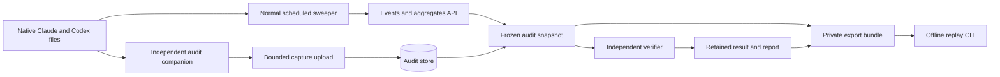

# Self-audit architecture

This guide explains the self-audit subsystem as implemented on the default branch. It is for maintainers and operators who need to trace a figure from local evidence through the frozen comparison and offline replay. Start with the [user guide](self-audit-user-guide.md) for the UI workflow and the [operator guide](self-audit.md) for configuration and recovery procedures.

## Boundaries and data flow



The normal sweeper (`clients/observatory-sweep.mjs`) posts daily, source and model snapshots to `/api/events` and reconciles previous local snapshots. It owns normal operational collection. The audit companion (`clients/observatory-audit.mjs` and `clients/audit/`) extracts a bounded, independently qualified set of native usage facts. The verifier in `src/AiObservatory.Audit/` does not call the normal collector's parser, the production pricing calculator or a provider API. This separation makes agreement meaningful, while shared upstream files and missing history remain explicit limits.

| Component            | Responsibility                                                                                                                               | Main code                                                                                          |
| -------------------- | -------------------------------------------------------------------------------------------------------------------------------------------- | -------------------------------------------------------------------------------------------------- |
| Dashboard            | Choose scope, inspect readiness and runs, request capture, present results and submit displayed-total observations.                          | `src/AiObservatory.Web/src/pages/SelfAuditPage.tsx`, `src/AiObservatory.Web/src/components/audit/` |
| Local companion      | Inspect explicit roots, extract allowlisted Claude/Codex facts, maintain private identity/state and upload manifest/chunks.                  | `clients/observatory-audit.mjs`, `clients/audit/`                                                  |
| Audit API and worker | Authenticate roles and machines, coordinate capture/run leases, freeze inputs, invoke verifier, retain reports, serve exports and retention. | `src/AiObservatory.Api/Audit/`                                                                     |
| Audit store          | Persist runs, credentials, capture chunks, frozen snapshots, findings, export reservations and retention deadlines.                          | `src/AiObservatory.Data/Audit/`                                                                    |
| Independent verifier | Apply versioned rules to frozen facts and produce canonical verdicts and findings.                                                           | `src/AiObservatory.Audit/`                                                                         |
| Offline CLI          | Validate a private bundle and replay or explicitly reevaluate without API, database or source files.                                         | `src/AiObservatory.Audit.Cli/`, `src/AiObservatory.Audit/Bundles/`                                 |

## Collection and trust

The companion requires Node 24 or later and explicit source roots. It does not discover a home directory. It accepts only qualified Claude and Codex formats; other local sources and unknown formats are reported as unsupported. Its upload contains allowlisted usage fields, provenance and hashed identities, not conversation bodies, tool arguments/results, credentials, environment variables or absolute native paths. Optional raw hashes in `local.json` remain local and must not be uploaded. See the [companion protocol](../clients/audit/README.md) for exact caps and restart behavior.

An administrator registers a machine and issues its one-time credential. The companion authenticates using `X-Observatory-Audit-Key`, scoped to that machine's capture leases; this is separate from ordinary dashboard/API authority. The companion's private identity generation is part of continuity: losing the identity directory starts a new generation. Viewer access is restricted to summaries, sanitized findings and reports. Admin authority is required for runs, detailed evidence, replay, exports, probes and retention changes. Downloaded bundles need private storage because they contain audit evidence.

The ordinary path uses a worker to request and receive bounded captures, including machines that may come online later. A selected one-shot invocation exists for a separately controlled exact run/revision/scope binding; it is not the general UI workflow and has different recovery semantics. The [operator guide](self-audit.md#optional-exact-selected-invocation) records its constraints. `Audit__Enabled` is false by default; ordinary background execution also requires its worker to be enabled. Disabled audit endpoints return 404.

## Freeze, verify and publish

1. A run stores its selected UTC dates, source instances, machine and checks. Readiness lists available captures and diagnostics; it cannot prove that the underlying native history is complete. Missing captures can wait for a companion or be explicitly acknowledged as partial.
2. Captures are uploaded as bounded manifests and chunks, then sealed. The service validates scope and source identity, provenance, hashes and record limits before treating evidence as usable.
3. `AuditSnapshotService` materializes the selected captured facts and the Observatory's relevant events, aggregates, spend, source status, pricing applications/catalog evidence and any presentation observation into a frozen input. Database reads use a repeatable-read transaction. Canonical bytes and a digest identify that input; verification runs outside the transaction.
4. The independent verifier evaluates the frozen input under its recorded schema, verifier and rule identity. Current identity is **schema 1, verifier 1.1.0, rules 2**. Integer counts remain exact and monetary arithmetic uses canonical decimals. A worker lease and run revision fence publication so stale work cannot replace a newer state.
5. The API retains canonical result, coverage, findings and a readable report. A completed processing state is separate from a Matched verdict. Replay and displayed-total verification create linked evaluations while preserving the original.

Checks cover source accounting, daily attribution, event aggregation, pricing arithmetic, displayed totals and billing reconciliation where supported. A mismatch dominates the overall verdict. An incomplete or unsupported executed check makes the overall result Incomplete; so does a scope with no executed checks. Explicit partial-evidence acknowledgement prevents an overall Matched verdict even when available arithmetic agrees. The displayed-total check observes the current frontend's summary and formatter against all frozen aggregate/spend pages; it is not an external proof of rendering or invoice accuracy. Billing reconciliation remains unsupported without qualified billing evidence and rules.

Versioned verifier identities matter. Normal replay requires compatible recorded input and installed verifier/rules. An explicit reevaluation with a newer installed identity writes a linked new evaluation and preserves the recorded result. Do not compare verdicts from different identities as if they were the same calculation.

## Retention and failure behavior

Capture evidence defaults to 90 days after sealing and report summaries to 365 days after completion. Changed policy affects future deadlines; it does not extend existing evidence. Export reserves a consistent read while building a bounded ZIP. The default limits are two concurrent exports per instance, two minutes, 512 MiB per admitted cohort and 1 GiB combined temporary budget. Capture deletion uses a read-first impact digest and `If-Match`; a stale impact returns 412. Expired or deleted evidence can return 410 even while a summary remains readable. Server deletion cannot retract a downloaded bundle.

Capture caps, offline machines, lost source files, unqualified formats, missing closure, old pricing rows without application/catalog provenance, or absent presentation probes produce explicit gaps. Matching stored event aggregation does not establish source completeness. A run can be cancelled, fail or finish Incomplete; none of these states should be silently presented as zero usage. Cancellation and credential revocation fence future owned writes, but do not act as a hard kill of already running code or erase separately downloaded files. A report is not a database backup and cannot reconstruct a missing bundle.

## Offline replay and maintenance checks

The private ZIP is data only. The CLI validates bundle bounds and hashes, then reproduces the canonical result with a compatible trusted verifier; it needs .NET 10 but no database, provider access or Node runtime. Preserve the bundle, its checksum, verifier archive and source-commit provenance before retention expiry. From an extracted verifier archive:

```sh
dotnet AiObservatory.Audit.Cli.dll replay <private-bundle.zip> --output <new-output-directory> --verifier-version 1.1.0
```

The CLI writes `result.json`, `result.sha256` and `report.txt` in a new directory. Exit `0` is Matched, `2` Mismatched, `3` Incomplete and `4` invalid/incompatible/failed. A matching digest and exit `3` can be a successful deterministic replay of an Incomplete audit. `--reevaluate` requests a new evaluation under the installed identity.

Useful focused checks from the repository root:

```sh
node --test clients/observatory-sweep.test.mjs
node --test clients/observatory-audit.test.mjs clients/audit-poll.test.mjs clients/audit-selected-capture.test.mjs clients/audit-transport-budget.test.mjs
dotnet build src/AiObservatory.Audit.Cli --configuration Release
node scripts/audit-replay-smoke.mjs
npm --prefix src/AiObservatory.Web test -- src/docs/docs.test.tsx
```

The committed smoke uses invented evidence and checks deterministic replay and explicit reevaluation. It is not a certificate for any installation's source completeness. For a current installation, retain the run ID, scope, verifier identity, input digest, check-level coverage and private export as the audit trail.
